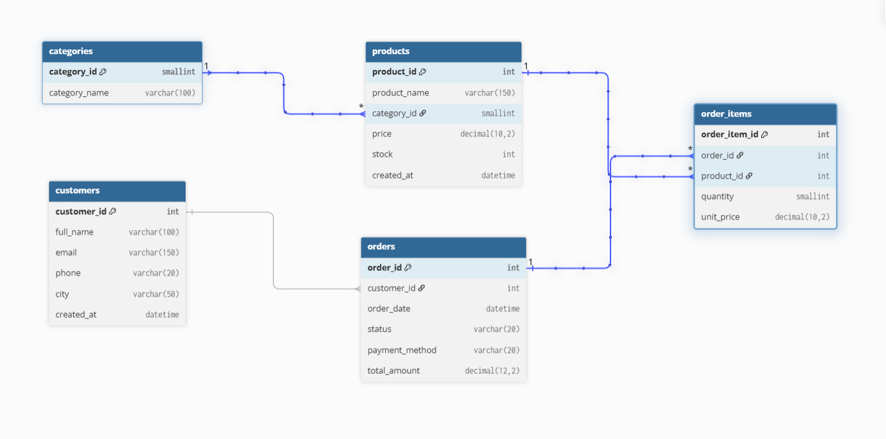
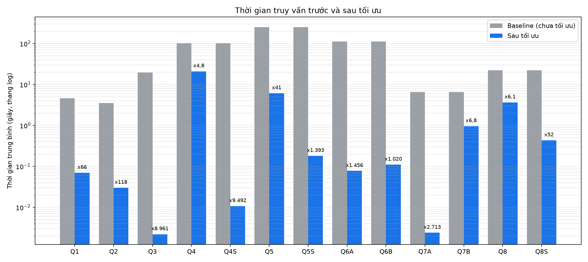

# Tối ưu SQL cho Big Data trên MySQL
 
Bài tập lớn học phần **Tích hợp và phân tích dữ liệu lớn**
Đề tài: **SQL và cơ sở dữ liệu: Tối ưu SQL, từ câu truy vấn đến execution plan** (Project 1: Tối ưu SQL cho Big data)
 
- Nhóm: 14
- Thành viên:
- 23010216-Phạm Bá Hiếu
- 23010272-Đào Quỳnh Nga
- 23010260-Đoàn Thị Thu Thảo
- Giảng viên: ThS. NCS. Bùi Anh Tuấn
---
 
## 1. Giới thiệu
 
Dự án đo và giải thích **vì sao một câu truy vấn SQL chậm và làm thế nào để nhanh hơn**, trên một cơ sở dữ liệu thương mại điện tử mô phỏng có hàng triệu dòng (MySQL 8, InnoDB).
 
Tám truy vấn nghiệp vụ được viết ở dạng "chưa tối ưu", đo thời gian và đọc execution plan bằng `EXPLAIN ANALYZE`, sau đó được tối ưu **từng bước một** (mỗi bước chỉ đổi một nhóm thứ, rồi đo lại) để biết chính xác kỹ thuật nào mang lại bao nhiêu cải thiện và đánh đổi bằng gì.
 
### Các kỹ thuật được khảo sát
 
| Nhóm | Nội dung |
|---|---|
| Index | Index đơn, composite index, covering index, xóa index thừa (tiền tố) |
| Viết lại truy vấn | Bỏ hàm bọc cột, thay subquery tương quan bằng JOIN hoặc window function, gom nhóm trước khi join, keyset pagination, deferred join |
| Tính sẵn | Bảng tổng hợp (materialized view làm thủ công) và cách làm mới |
| Cấu trúc bảng | Partitioning theo năm (có phân tích ràng buộc khóa chính) |
| Chi phí đánh đổi | Tốc độ `INSERT`, `UPDATE`, dung lượng index, độ lỗi thời của bảng tổng hợp |
| Độ tin cậy của phép đo | Nhiều lần đo, trung bình, trung vị, độ lệch chuẩn; hiện tượng plan thay đổi (plan regression) |
 
### Dữ liệu
 
| Bảng | Số dòng | Vai trò |
|---|---|---|
| `categories` | 20 | Danh mục sản phẩm |
| `customers` | 100.000 | Khách hàng (phân bố thành phố lệch) |
| `products` | 10.000 | Sản phẩm (phân bố danh mục lệch) |
| `orders` | 2.000.000 | Đơn hàng 2020 đến 2025, `order_id` tăng theo thời gian |
| `order_items` | 5.300.810 | Chi tiết đơn hàng, `total_amount` luôn khớp tổng chi tiết |
 
Dữ liệu do `python/generate_data.py` sinh ngẫu nhiên có cố định hạt giống (`SEED = 42`), nên mọi người sinh ra cùng một bộ dữ liệu. Ban đầu các bảng **chỉ có khóa chính**, không có khóa ngoại và index phụ, để các truy vấn "chưa tối ưu" có baseline chậm đúng nghĩa (InnoDB tự tạo index cho cột khóa ngoại).
 

 
Các đường nối trong ERD là quan hệ logic, được đảm bảo bởi script sinh dữ liệu.
 
---
 
## 2. Kết quả chính
 
Thời gian trung bình (giây) đo bằng `python/benchmark.py`.
 
| Truy vấn | Kỹ thuật | Baseline (s) | Sau tối ưu (s) | Tăng tốc |
|---|---|---|---|---|
| Q1 Đơn hoàn tất trong tháng | Covering index | 4,612 | 0,0694 | 66 lần |
| Q2 Doanh thu tháng 3/2025 | Bỏ hàm bọc cột + covering index | 3,543 | 0,0301 | 118 lần |
| Q3 Tìm khách theo email và đơn | Index email + index `customer_id` | 19,71 | 0,0022 | khoảng 9.000 lần |
| Q4 Doanh thu theo tháng, danh mục | Covering index | 101,56 | 21,00 | 4,8 lần |
| Q4S (như Q4) | Bảng tổng hợp | 101,56 | 0,0107 | khoảng 9.500 lần |
| Q5 Top 3 sản phẩm mỗi danh mục | Gom nhóm trước + covering index | 250,71 | 6,107 | 41 lần |
| Q5S (như Q5) | Bảng tổng hợp | 250,71 | 0,180 | khoảng 1.400 lần |
| Q6A Giá cao hơn trung bình danh mục | JOIN thay subquery tương quan | 112,67 | 0,0774 | khoảng 1.500 lần |
| Q6B (như Q6A) | Window function | 112,67 | 0,1105 | khoảng 1.000 lần |
| Q7A Phân trang sâu | Keyset + `FORCE INDEX` | 6,511 | 0,0024 | khoảng 2.700 lần |
| Q7B (như Q7A) | Deferred join | 6,511 | 0,9611 | 6,8 lần |
| Q8 Top 10 khách ở Hà Nội | Composite + covering index | 22,37 | 3,657 | 6,1 lần |
| Q8S (như Q8) | Bảng tổng hợp | 22,37 | 0,4331 | 52 lần |
 

 
Bảng đầy đủ kèm độ lệch chuẩn nằm ở `results/tables/so_sanh_truoc_sau.md`, tiến trình từng bước ở `results/charts/tien_trinh_tung_buoc.png`.
 
---
 
## 3. Bài học rút ra
 
1. **Index đúng chỗ cho cải thiện lớn nhất**: Q3 từ 19,7 giây xuống mili giây khi có index để bắt đầu từ phía có điều kiện lọc.
2. **Hàm bọc cột vô hiệu hóa index**: Q2 thêm index mà không sửa truy vấn thì không nhanh hơn chút nào; chỉ khi viết lại điều kiện thành khoảng ngày mới nhanh gấp khoảng 20 lần.
3. **Optimizer không phải lúc nào cũng dùng index**: Q7 bỏ qua index vì index không chứa đủ cột, và nó có lý do.
4. **Covering index rất mạnh nhưng đắt**: tổng index (444 MB) lớn hơn tổng dữ liệu (327 MB); `INSERT` chậm hơn khoảng 2,0 đến 2,3 lần và `UPDATE` cột nằm trong index chậm hơn 3,1 lần.
5. **Index chỉ sửa đường truy cập, không giảm lượng dữ liệu phải xử lý**: Q4 vẫn mất 21 giây vì phải xử lý 620.000 dòng; bảng tổng hợp mới đưa về mili giây, đổi lại dữ liệu có thể lỗi thời và phải làm mới.
6. **Partitioning không thay thế index**: chỉ cải thiện khoảng 5,8 lần (tỷ lệ với phần bảng bị loại), trong khi covering index cho 66 đến 118 lần.
7. **Kế hoạch thực thi có thể thay đổi**: Q7A từng nhanh (2,6 ms) rồi chậm 9,8 giây sau khi thêm index và đổi thống kê, phải cố định bằng `FORCE INDEX`; Q8S đổi kế hoạch giữa hai lần đo. Cần đo lại hiệu năng sau mỗi thay đổi.
8. **Ước lượng của optimizer có thể sai lớn** (Q2, Q3, Q7A), nên luôn so sánh số dòng ước lượng (`rows=`) với thực tế (`actual ... rows=`) trong `EXPLAIN ANALYZE`.
---
 
## 4. Cấu trúc thư mục
 
```
.
├── sql/
│   ├── schema/      # tạo database, bảng, index, bảng tổng hợp, thí nghiệm partition, chi phí ghi
│   ├── data/        # script nạp dữ liệu (các file CSV sinh ra bị bỏ qua, không đưa lên Git)
│   └── queries/     # truy vấn trước và sau tối ưu (mỗi truy vấn có nhãn "-- @Qn | ...")
├── python/
│   ├── config.example.py     # mẫu cấu hình kết nối (sao chép thành config.py)
│   ├── generate_data.py      # sinh 5 file CSV
│   ├── load_data.py          # nạp CSV vào MySQL
│   ├── benchmark.py          # EXPLAIN ANALYZE + đo thời gian nhiều lần
│   ├── make_report_tables.py # gộp kết quả thành bảng và biểu đồ
│   ├── test_connection.py    # kiểm tra kết nối
│   └── requirements.txt
├── results/
│   ├── plan/          # execution plan dạng text của từng lần đo
│   ├── tables/        # kết quả benchmark (CSV), bảng so sánh, chi phí ghi, dung lượng
│   ├── charts/        # biểu đồ
│   ├── screenshots/   # ảnh Visual Explain và ảnh Workbench
│   └── ERD/
├── report/            # báo cáo Word
└── slides/            # slide thuyết trình
```
 
Các file SQL quan trọng:
 
| File | Nội dung |
|---|---|
| `sql/schema/01_create_database.sql` | Tạo database `shop_db` và user `bt_user` |
| `sql/schema/02_create_tables.sql` | Tạo 5 bảng (chỉ khóa chính) |
| `sql/schema/03_create_indexes.sql` (+ `03b_drop_indexes.sql`) | Bước 1: index đơn |
| `sql/schema/04_create_indexes_step3.sql` (+ `04b_drop_indexes_step3.sql`) | Bước 3: composite và covering index (phần 3A, 3B, 3C) |
| `sql/schema/05_summary_tables.sql` | Bước 4: 3 bảng tổng hợp |
| `sql/schema/05b_partition_experiment.sql` | Bước 4: bản sao `orders_part` chia partition |
| `sql/schema/06_write_cost.sql` | Bước 5: bảng thử nghiệm chi phí ghi |
| `sql/queries/02_business_queries_unoptimized.sql` | 8 truy vấn baseline |
| `sql/queries/03_business_queries_optimized.sql` | Bản viết lại (Q2, Q5, Q6A, Q6B, Q7A, Q7B) |
| `sql/queries/04_business_queries_final.sql` | Bộ truy vấn cuối cùng |
| `sql/queries/05_business_queries_step4.sql` | Truy vấn đọc bảng tổng hợp và bảng partition |
 
---
 
## 5. Yêu cầu hệ thống
 
- **MySQL Server 8.0.18 trở lên** (cần `EXPLAIN ANALYZE`); đã chạy trên 8.0.46. Lệnh `mysql` phải gọi được từ terminal.
- **Python 3.11 trở lên**.
- Khoảng 8 GB RAM (cấu hình dùng `innodb_buffer_pool_size` = 1 GB) và khoảng 3 GB ổ đĩa trống (CSV khoảng vài trăm MB, cơ sở dữ liệu kèm index khoảng 1 GB).
- Tùy chọn: MySQL Workbench (Visual Explain), Git.
Các lệnh dưới đây viết cho **PowerShell trên Windows** và chạy từ **thư mục gốc dự án**. Trên macOS hoặc Linux, đổi `.venv\Scripts\activate` thành `source .venv/bin/activate` và dấu `\` trong đường dẫn thành `/`.
 
---
 
## 6. Hướng dẫn chạy từ đầu
 
### Bước 1: Lấy mã nguồn
 
```powershell
git clone <địa chỉ repo>
cd <thư mục repo>
```
 
### Bước 2: Chuẩn bị MySQL
 
Đăng nhập bằng quyền root (`mysql -u root -p`) và chạy:
 
```sql
SELECT VERSION();                                   -- phải từ 8.0.18 trở lên
SET GLOBAL local_infile = 1;                        -- cho phép nạp file CSV từ máy client
SET GLOBAL innodb_buffer_pool_size = 1073741824;    -- 1 GB, để các lần đo ổn định
```
 
Hai lệnh `SET GLOBAL` mất hiệu lực khi khởi động lại MySQL; nếu khởi động lại, chạy lại chúng trước khi nạp dữ liệu hoặc đo hiệu năng.
 
### Bước 3: Tạo môi trường Python
 
```powershell
python -m venv .venv
.venv\Scripts\activate
pip install -r python\requirements.txt
```
 
Nếu PowerShell chặn script kích hoạt: `Set-ExecutionPolicy -Scope CurrentUser RemoteSigned`.
 
### Bước 4: Tạo database và user
 
Mở `sql/schema/01_create_database.sql`, **đổi mật khẩu mẫu** `DoiMatKhauCuaBan#123` thành mật khẩu của bạn, rồi chạy bằng root:
 
```powershell
mysql -u root -p -e "source sql/schema/01_create_database.sql"
```
 
Lệnh này xóa và tạo lại database `shop_db`, tạo user `bt_user` có toàn quyền trên `shop_db`.
 
### Bước 5: Cấu hình kết nối Python
 
```powershell
Copy-Item python\config.example.py python\config.py
```
 
Mở `python/config.py` và điền **đúng mật khẩu vừa đặt ở bước 4**. File `config.py` đã nằm trong `.gitignore` nên sẽ không bị đưa lên Git.
 
Kiểm tra:
 
```powershell
python python\test_connection.py
```
 
Kết quả đúng: in phiên bản MySQL, tên `shop_db` và dòng `OK - kết nối thành công`.
 
### Bước 6: Tạo bảng
 
```powershell
mysql -u bt_user -p shop_db -e "source sql/schema/02_create_tables.sql"
```
 
### Bước 7: Sinh dữ liệu
 
```powershell
python python\generate_data.py
```
 
Mất khoảng 15 giây, tạo 5 file CSV trong `sql/data/` (khoảng 5,3 triệu dòng chi tiết đơn và 2 triệu đơn).
 
### Bước 8: Nạp dữ liệu
 
```powershell
python python\load_data.py
```
 
Mất vài phút. Script tự tính đường dẫn file nên không cần sửa gì. (File `sql/data/03_load_bigdata.sql` là bản SQL thuần dùng **đường dẫn tuyệt đối**, chỉ dùng được nếu bạn sửa các đường dẫn trong đó cho khớp với máy mình.)
 
### Bước 9: Kiểm tra dữ liệu
 
```powershell
mysql -u bt_user -p shop_db -e "SELECT 'customers' t, COUNT(*) n FROM customers UNION ALL SELECT 'products', COUNT(*) FROM products UNION ALL SELECT 'orders', COUNT(*) FROM orders UNION ALL SELECT 'order_items', COUNT(*) FROM order_items;"
```
 
Kết quả đúng: `customers` 100000, `products` 10000, `orders` 2000000, `order_items` 5300810.
 
### Bước 10: Đo baseline
 
```powershell
python python\benchmark.py --label before
```
 
Mất khoảng 35 đến 45 phút (Q4, Q5, Q6 mỗi truy vấn chạy vài phút). Nên cắm sạc và đóng các ứng dụng nặng. Có thể nhấn Ctrl+C bất cứ lúc nào, kết quả các truy vấn đã xong vẫn được lưu. Muốn thử nhanh: `python python\benchmark.py --label test --only Q1,Q2 --runs 2`.
 
Kết quả sinh ra:
- `results/plan/Qn_explain_before.txt`: execution plan của từng truy vấn,
- `results/tables/benchmark_before.csv`: thời gian trung bình, trung vị, độ lệch chuẩn, từng lần đo,
- `results/tables/meta_before.txt`: phiên bản MySQL, cấu hình đo.
---
 
## 7. Tái lập toàn bộ quá trình tối ưu
 
Mỗi lần đo dùng một nhãn riêng (`--label`) để lưu thành file riêng. Mỗi dòng dưới đây nối tiếp trạng thái của dòng trước (index đã tạo vẫn còn).
 
| Bước | Thay đổi (chạy file SQL bằng `mysql -u bt_user -p shop_db -e "source ..."`) | Lệnh đo |
|---|---|---|
| Baseline | (không) | `python python\benchmark.py --label before` |
| 1. Index đơn | `sql/schema/03_create_indexes.sql` | `... --label step1_index --only Q1,Q2,Q3,Q7` và `... --label step1_q4q8 --only Q4,Q8` |
| 2. Viết lại | (không đổi cấu trúc) | `... --label step2_rewrite --queries sql\queries\03_business_queries_optimized.sql` |
| 3A. Covering `orders` | phần 3A của `sql/schema/04_create_indexes_step3.sql` | `... --label step3a_orders_idx --queries sql\queries\04_business_queries_final.sql --only Q1,Q2` |
| 3B. Covering `order_items` | phần 3B | `... --label step3b_items_idx --queries sql\queries\04_business_queries_final.sql --only Q4,Q5` |
| 3C. Index cho Q8, xóa index thừa | phần 3C | `... --label step3c_q8 --queries sql\queries\04_business_queries_final.sql --only Q3,Q8` |
| 4. Bảng tổng hợp và partition | `sql/schema/05_summary_tables.sql`, `sql/schema/05b_partition_experiment.sql` | `... --label step4_summary_part --queries sql\queries\05_business_queries_step4.sql` |
| 5. Chi phí ghi | `sql/schema/06_write_cost.sql` (đo thủ công trong Workbench, đọc cột *Duration*) | (không dùng benchmark.py) |
| Đo cuối | xóa `orders_part` và các bảng thử nghiệm: `DROP TABLE IF EXISTS orders_part;` | `... --label final_core --queries sql\queries\04_business_queries_final.sql`, `... --label final_summary --queries sql\queries\05_business_queries_step4.sql --only Q4S,Q5S,Q8S`, `... --label final_q7a_fix --queries sql\queries\04_business_queries_final.sql --only Q7A` |
| Tổng hợp | (không) | `python python\make_report_tables.py` |
 
(Mỗi lệnh đo bắt đầu bằng `python python\benchmark.py`.) Toàn bộ quá trình mất vài giờ, chủ yếu do các truy vấn chậm ở trạng thái đầu.
 
**Đường tắt để đến trạng thái cuối cùng** (không đo từng bước): chạy lần lượt `03_create_indexes.sql`, `04_create_indexes_step3.sql` (cả ba phần) và `05_summary_tables.sql` (khoảng 5 phút), rồi chạy hai lệnh `final_core` và `final_summary` ở bảng trên.
 
Mỗi lần đo ghi plan vào `results/plan/` (đặt tên `Qn_explain_<nhãn>.txt`), và script `make_report_tables.py` đọc đúng các nhãn trên để tạo `results/tables/so_sanh_truoc_sau.*` và các biểu đồ trong `results/charts/`.
 
---
 
## 8. Xử lý sự cố
 
| Triệu chứng | Nguyên nhân và cách xử lý |
|---|---|
| `The used command is not allowed with this MySQL version` khi nạp dữ liệu | `local_infile` chưa bật ở server (`SET GLOBAL local_infile = 1;`), hoặc `config.py` thiếu dòng `"allow_local_infile": True` (sao chép lại từ `config.example.py`) |
| `Access denied for user 'bt_user'` | Mật khẩu trong `config.py` khác mật khẩu đặt trong `01_create_database.sql` |
| `ModuleNotFoundError: No module named 'config'` | Chưa tạo `python/config.py` (bước 5), hoặc chạy script ở thư mục khác thư mục gốc |
| `'mysql' is not recognized` | Thêm thư mục `bin` của MySQL vào biến môi trường PATH rồi mở lại terminal |
| Tên tiếng Việt hiện thành `?` trong PowerShell | Lỗi hiển thị của console, dữ liệu không hỏng: chạy `chcp 65001` và thêm `--default-character-set=utf8mb4`, hoặc xem bằng MySQL Workbench |
| Các lần đo chậm và dao động nhiều | `innodb_buffer_pool_size` về 128 MB sau khi khởi động lại MySQL: chạy lại `SET GLOBAL ...` ở bước 2 |
| `Table '...' doesn't exist` | Chưa chạy bước 6 (tạo bảng) |
| Thời gian khác số trong README | Bình thường, phụ thuộc phần cứng. So sánh **tỷ lệ** trước và sau, không so số giây tuyệt đối |
| Một truy vấn bất ngờ chậm đi sau khi thêm index | Có thể optimizer đổi kế hoạch (như Q7A): xem plan trong `results/plan/`, so `rows=` ước lượng với `actual rows=` |
 
---
 
## 9. Lưu ý
 
- Mật khẩu trong `sql/schema/01_create_database.sql` chỉ là **mật khẩu mẫu**. Hãy đổi trước khi chạy và không dùng lại mật khẩu thật ở nơi khác.
- Các file CSV trong `sql/data/` rất lớn nên không được đưa lên Git; luôn tạo lại bằng `generate_data.py` (hạt giống cố định nên kết quả giống nhau).
- Số liệu thời gian đo trên một máy cụ thể (cấu hình xem `results/tables/meta_*.txt` và ghi chú trong báo cáo). Cùng một truy vấn giữa hai phiên đo có thể lệch khoảng 2 lần, và nhiều lần ở mức mili giây, vì vậy kết luận nên dựa vào bậc độ lớn và tỷ lệ.
- `FORCE INDEX` ở Q7A cố định kế hoạch trong mã nguồn: nhanh và ổn định, nhưng không tự thích nghi nếu dữ liệu hoặc index thay đổi.
- Các bảng tổng hợp **không tự cập nhật**: sau khi có đơn mới phải làm mới (xây lại hoặc cập nhật tăng dần), xem phần thí nghiệm độ lỗi thời trong báo cáo.
## 10. Tài liệu
 
- Báo cáo: thư mục `report/`
- Slide thuyết trình: thư mục `slides/`
- Chi phí ghi và dung lượng: `results/tables/chi_phi_ghi.md`, `results/tables/dung_luong.md`